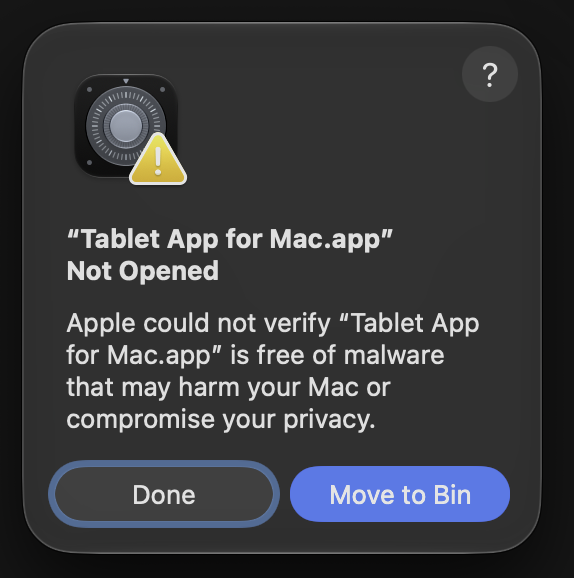
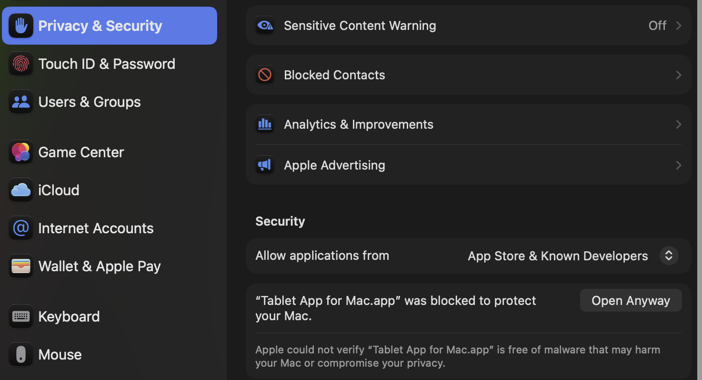
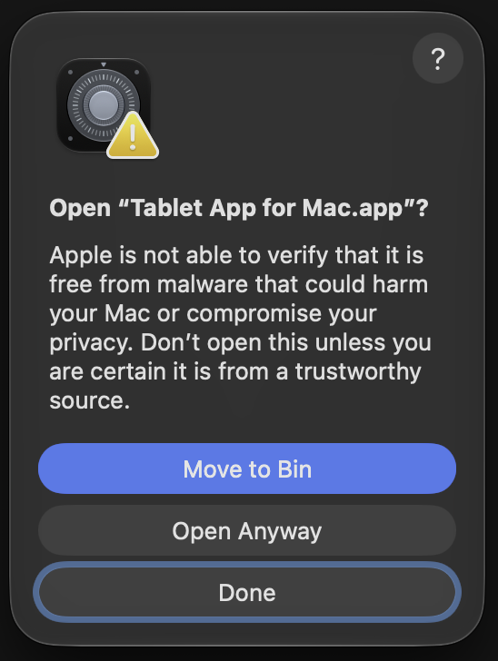
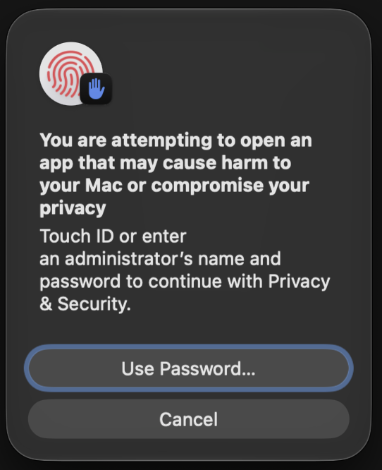
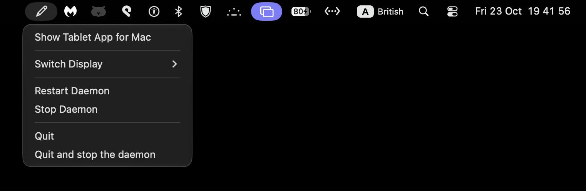
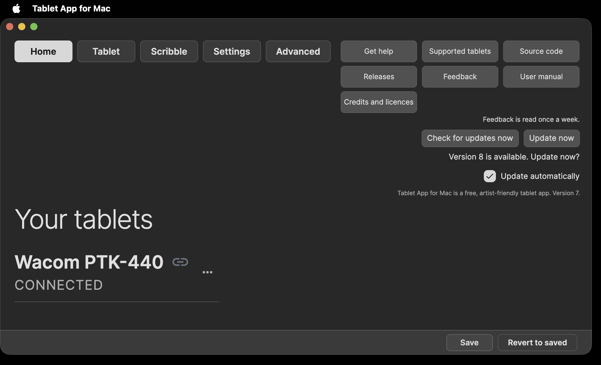

# Tablet App for Mac – User Manual

Version 7. British English. Screens are real screenshots from a Mac running earlier versions, so some may differ slightly.

## Before you start

Tested only on an Apple silicon Mac with macOS 27.0.1 and a Wacom Intuos4 Small (PTK-440). Other systems and tablets are untested. Use at your own risk.

## Quick start

- Quit the Wacom driver if it is running (see Wacom driver conflict).
- If the Wacom driver is installed, remove it first with Wacom's own uninstaller (Applications › Wacom Tablet › Wacom Tablet Utility › Tablet Software › Uninstall), then restart your Mac. The app warns you if it still finds it, but never removes it itself.
- Open Tablet App for Mac. A setup window shows two rows, **Read the pen** and **Move the pointer**. Click each button and turn the app on in the list that opens; each row turns green with a tick.
- In System Settings › Privacy & Security › **Input Monitoring**, turn on Tablet App for Mac. This lets the app read the pen.

- In System Settings › Privacy & Security › **Accessibility** (called **Device Control and Data Access** on macOS 27), turn on Tablet App for Mac. This lets the pen move the pointer. Quit and reopen the app.

- If the pen draws in Scribble but the pointer doesn't move, Accessibility is missing. Home shows **Open Device Control and Data Access** (called Accessibility on older macOS).
- On **Home**, check the tablet card shows your tablet as connected.
- Open the tablet, choose **Pen** in the Tool row, and set **Tip Feel**.
- Set **Mapping** to the display you draw on.
- Under **Functions**, set the ExpressKeys and the **Touch ring** modes.
- Click **Save** in the footer. Unsaved changes are kept and offered again after a shutdown.
- Test in **Scribble**.

## Introduction and requirements

Tablet App for Mac sets up a pen tablet on macOS: pen feel, buttons, mapping, ExpressKeys and Touch Ring modes, with per-app settings. Tablet input comes from the OpenTabletDriver daemon, which the app starts.

- A Mac with Apple silicon (tested) or Intel (untested).
- macOS 15 or later (the versions .NET 10 supports: 15, 26 and 27).
- The OpenTabletDriver daemon (included in the app).
- Input Monitoring and Accessibility permissions (Accessibility is called Device Control and Data Access on macOS 27).
- Uninstall the Wacom driver first, as both can't run at once.

## Install and first launch

**Already on Version 6? Install Version 7 by hand once, then redo both permissions once (the setup window guides you). After that, updates install from inside the app; if macOS asks for the permissions again, the setup window guides you.**

1. Open **Tablet-App-for-Mac.dmg** and drag **Tablet App for Mac** onto the **Applications** folder.
2. Open the app from Applications. The first time, your Mac may say the app was not opened. Click **Done**. Do not click **Move to Bin**.

3. Open **System Settings › Privacy & Security** and scroll down to **Security**. Next to "Tablet App for Mac.app was blocked to protect your Mac", click **Open Anyway**.

4. macOS asks once more. Click **Open Anyway**. Do not click the blue **Move to Bin** button.

5. Confirm with Touch ID, or click **Use Password…** and enter your Mac login password. The app then opens, and macOS won't ask again.

- macOS asks for **Input Monitoring** (to read the tablet) and **Accessibility** (to send keys and clicks). Allow both in System Settings › Privacy & Security, then relaunch the app.
- The app starts its OpenTabletDriver daemon. The menu bar icon stays while it runs.
- To start the app when you log in, switch on **Start automatically when I log in** in **Settings › System** (or add it in System Settings › General › Login Items). At login the app starts silently: only the pen icon in the menu bar shows. Click it to open the window.
- Only one copy runs. Opening the app again brings the running copy to the front.

## Home

- **Your tablets**: one card per connected or remembered tablet. Click a card to open its settings.
- Card **⋯** menu: **Open tablet settings**, **Forget this tablet**.
- Health rows: problems found, each with **Fix** or a specific action where one exists. **Fix** works with the pen even while the pen tip or eraser is disabled.
- **Open daemon page**: shown when the daemon is not reachable.

## Tablet page layout

- **Device**: the selected tablet. The switcher lists connected and remembered tablets.
- **Tool**: **Functions** (ExpressKeys, Touch ring), **Pen** (pen, eraser, mapping), **More** (about, calibration, hover, filters, json).
- **Application**: **All**, or a specific app. **+** adds an app with its own settings; **−** removes it.
- **Refresh** reloads the tablet's settings from the daemon.
- Footer: **Options…** (Settings), **?** (this manual).

## Tablet › Pen

| Control | Default | Function |
|---|---|---|
| Tilt › Turn tilt off | Off | Stops sending tilt. Shared with the eraser. |
| Tip Feel | Middle (linear) | Soft to Firm pressure curve. |
| Customise… | Closed | Shows the curve, presets **Soft**, **Linear (no curve)**, **Hard**, the input range sliders and **Cut below input minimum (dead zone)** (off). |
| Current pressure | Live | Pressure after the curve; tooltip shows the raw value. |
| Button 1 / Button 2 cards | Default (right click) / Default (middle click) | **Change…** opens the function editor; **Default** restores it. |
| Pen button test | Live | Press a barrel button: its number on the pen picture lights while held, and the line above the cards reads "Button 2 pressed." (or 1). |
| Movement | Normal (Absolute) | Absolute maps the pen to the screen; Mouse (Relative) moves the cursor like a mouse. |
| Position smoothing | 0.00 | Steadies the cursor, with some lag. |
| Disable pen tip | Off | The tip makes no strokes; the bar reads 0%. |
| Disable pressure sensitivity | Off | Every stroke uses the Manual Pen Tip Pressure while pressed, in every app. |
| Manual Pen Tip Pressure | 30% | Own frame under Tip Feel. The pressure used while pressure sensitivity is off (0 to 100%). |

## Tablet › Eraser

The Eraser tab has the same controls as Pen. Separate for the eraser: **Disable eraser** and **Manual Eraser Pressure** (own frame under Eraser Feel; used while pressure sensitivity is off). Shared with Pen (marked "Shared with Pen"): tilt, the Feel curve (one curve for tip and eraser), pressure sensitivity, Movement and Position smoothing. The button cards are the pen's barrel buttons.

## Tablet › Mapping

| Control | Default | Function |
|---|---|---|
| Active area | Whole tablet | Drag the area or its corners. |
| Rotation | 0° | 180° puts the ExpressKeys on the other side; 90° and 270° are portrait. Recalibrate after rotating. |
| Display / All displays | Main display | The display the area maps to. |
| Force proportions | On | Keeps the area at the display's aspect ratio. |
| Display Settings | – | Opens macOS Displays settings. |

## Tablet › Functions › ExpressKeys

- Press a key on the tablet to light its row.
- Row **⋯**: **Edit…** opens the function editor, **Clear** removes the action.
- The enable switch turns all ExpressKey actions off or on; actions are kept.
- **Default**: clears every ExpressKey action, after asking.

Function editor: **Keyboard** (a shortcut; Cmd, Ctrl, Shift and Option are held modifiers), **Mouse** (Left, Right, Middle click, Back and Forward button), **Scroll** (up, down, left, right), **Media** (Mute, Volume down, Volume up, Play / Pause, Previous track, Next track, Stop). **Save**, **Cancel**, **Clear**.

## Tablet › Functions › Touch ring

- **Enable wheels**: On. Pauses all ring actions without deleting them.
- **Touch Ring modes**: On. "4 modes. Press the ring's centre button to switch."
- **Show touch ring setting (on-screen mode display)**: On. Shows the mode name when you switch.
- The dial follows the ring live: the dot sits under your finger. The angle and turn direction show under the ring, for example "0° · Clockwise". 12 o'clock is 0° and 3 o'clock is 90°.
- The active mode is highlighted; its number is lit, centred, and also shows on the centre button.

- On-screen centre button: moves the highlight to the next mode. The tablet's centre button switches the driver's mode.
- Per mode: name, **On**, **Function** (Keystroke…, or the experimental drag actions, Photoshop only), **Speed** (Slow to Fast, slider or typed), and the **Clockwise** and **Anticlockwise** keys.
- **Default** restores the four modes:

| Mode | Clockwise | Anticlockwise | Every |
|---|---|---|---|
| Rotate | Option+F13 | Option+F14 | 10° |
| Zoom | Cmd+= | Cmd+− | 30° |
| Brush size | ] | [ | 8° |
| Brush hardness | Shift+] | Shift+[ | 60° |

## Tablet › More

- **about**: the tablet's model and features: digitiser resolution, pressure levels, pen buttons, **Tablet buttons** and wheels.

- **calibration**: **Start** shows full-screen targets; tap each, then **Apply**. **More calibration actions**: **View report…**, **Export calibration…**, **Import calibration…**, **Clear calibration**. The on/off switch compares with and without the correction. Calibrate only if the pointer sits away from the nib.
- **hover** (below): hover limit, off by default; 127 when first switched on (0 to 255). Stops cursor tracking past this distance.
- **filters**: the OpenTabletDriver filters on this tablet.
- **json**: the profile as the daemon stores it.

## Scribble

A test canvas with a precise crosshair cursor. If the canvas says "Drawing is off because the pen isn't set to follow the screen", click **Use pen on screen**: Movement becomes **Normal (Absolute)** and, if needed, the pen is mapped to all displays. The same settings are in **Tablet › Pen › Movement** and **Tablet › Mapping**. Draws with the processed pressure, so the curve, Disable pen tip and the Manual Pressure are visible.

 **Mark positions** dots each report. **Clear**, **Copy**. **Record** and **Stop** save a stroke recording.

## Settings

- **Theme**: **Themes** (Graphite, Silver, Charcoal, Rose, Burgundy, Custom, System; default Graphite), brightness, **Backdrops** (Solid colour, Generated gradient, **Add glow**, **Choose image…**), **Colours** (Highlight colour, Card colour). **Reset to defaults**.
- **Hotkeys**: global shortcuts for tablet actions and **Load a preset**. **Assign…**, **Clear**. Default: not set.
- **Presets**: see Presets and saving.
- **System**: **Start at login**. Switch on **Start automatically when I log in** to have the app start by itself when you log in to your Mac, with only the pen icon in the menu bar. **Open Login Items…** opens the same setting in macOS: System Settings › General › Login Items.

## Advanced

- **Daemon**: status; **Start**, **Restart**, **Stop**, **Open OpenTabletDriver's interface**, **Open the folder holding this daemon**.
- **Plugins**: **Rescan plugin folder**, **Open plugin folder**.
- **Tablet configs**: **Check for more configs**, **Install**, **View**.
- **Console**: severity filter, text filter, **Auto-scroll** (on), copy as text, Markdown or HTML, **Clear**.
- **Diagnostics**: **Start** and **Stop** live reports.

## About and Options

**About** shows the version and links: **Get help** (this manual), **Supported tablets**, **Source code**, **Releases**, **User manual**, **Credits and licences**, **Feedback**. Feedback is read once a week. **Options…** opens Settings.

## Presets and saving

- Changes apply at once; the footer shows **Save** and **Revert to saved** while there are unsaved changes.
- **Save** writes the settings. **Revert to saved** goes back to the last save.
- After a shutdown or crash with unsaved changes, the app offers the snapshot again at the next launch.
- **Save as preset** stores the whole configuration under a name. Preset **⋯**: **Update from current settings**, **Duplicate**, **Rename…**, **Delete**. **Load** applies it.

## The pen menu

The pen icon in the menu bar at the top of the screen shows that Tablet App for Mac is running. Click it to open its menu.

The **daemon** is the background part of the app that reads the pen and moves the pointer. It keeps working while the window is closed.

- **Show Tablet App for Mac** opens the app's window.
- **Switch Display** chooses which screen the tablet draws on, when you have more than one screen.
- **Restart Daemon** stops the background part and starts it again. Try this first if the pen stops responding.
- **Stop Daemon** stops the background part, so the pen stops working until you start it again. While it is stopped, the menu shows **Start Daemon** instead.
- **Quit** closes the app and removes the pen icon. The background part keeps running, so the pen still works with the settings you saved.
- **Quit and stop the daemon** closes the app and stops the background part too, so the pen stops working until you open the app again.

## Quitting

- **Cmd+Q** closes the window. The app stays in the menu bar and the tablet keeps working.
- **Quit** in the pen menu closes the app; **Quit and stop the daemon** also stops the pen (see The pen menu). With unsaved changes it asks "Save changes before quitting?": **Cancel** keeps the app open, **Don't Save** quits without saving, **Save** saves and quits.
- Quitting also happens at shutdown and logout; unsaved changes are then kept and offered at the next launch.

## Tested system and tablet

macOS 27.0.1 on Apple silicon, Wacom Intuos4 Small (PTK-440). Nothing else has been tested; the Intel version is untested.

## Wacom driver conflict

The Wacom driver and OpenTabletDriver cannot both use the tablet. Quit or uninstall the Wacom driver before using this app. Home shows a warning while it is running.

## Updating

- From Version 7, the app checks for updates once a month. When there is a new version, it asks **Update now?** Click **Update now** and the app downloads it, checks it, installs it and opens again by itself.
- To check any time, click **Check for updates now** on **Home** (top right, under the About links).
- **Update automatically** is an optional setting just below it. It is off unless you turn it on.

- After an update, macOS may ask for the two permissions again (Input Monitoring and Device Control and Data Access). The setup window opens and walks you through it.
- **Coming from Version 6:** install Version 7 by hand once (see Install and first launch), then redo both permissions once. In System Settings › Privacy & Security, open **Input Monitoring** and **Device Control and Data Access** (called **Accessibility** on older macOS). In each, select Tablet App for Mac, remove it with **−**, add it again with **+**, and switch it on. The setup window walks you through this.
- **By hand, if you prefer:** quit the app, replace it in Applications with the new version, and open it. If the pen stops working afterwards, redo the two permissions as above.

## Going back to an earlier build

Download the earlier build from Releases and replace the app. Settings are kept. Re-add the permissions as under Updating if needed.

## Uninstalling

- Quit from the menu bar.
- Delete the app from Applications.
- Remove its entries from **Input Monitoring** and **Accessibility** (on macOS 27: **Device Control and Data Access**) with **−**.
- Remove its Login Item if you added one (System Settings › General › Login Items).
- Optional: delete its settings folder in ~/Library/Application Support.

## Credits and licences

Tablet App for Mac is a modified version of OpenTabletArtist by TheSevenPens (GPL-3.0) and uses OpenTabletDriver (LGPL-3.0). The full list of packages and licence texts is on the Credits and licences page.

## Glossary

- **Tip Feel**: the pressure curve, from Soft to Firm.
- **Touch Ring modes**: up to four sets of ring actions, switched with the centre button.
- **Preset**: a named copy of the whole configuration.
- **Application row**: per-app settings; **All** applies everywhere else.
- **Shared with Pen**: an Eraser setting that is the same setting as on the Pen tab.

## Not written here

Troubleshooting and the per-app notes (Photoshop, Affinity, PhotoCraft) are written separately. Per-app shortcuts: not yet tested.
