# Tablet App for Mac – User Manual

App version 30. British English. Screens are real screenshots from a Mac; a few come from earlier versions, so some may differ slightly.

## Before you start

Made and tested on an Apple silicon Mac with macOS 27.0.1 and a Wacom Intuos4 Small (PTK-440). People using the app have told us it also works with the Intuos3 6x11 (PTZ-631W), Intuos4 Medium (PTK-640), Intuos5 touch Small, Medium and Large (PTH-450, PTH-650, PTH-850), Intuos Pro Medium 2013 (PTH-651), Intuos S Bluetooth (CTL-4100WL) and Bamboo Fun Small Pen & Touch (CTH-461) (see Tested system and tablet). Other tablets are untested. Use at your own risk.

## Quick start

- Quit the Wacom driver if it is running (see Wacom driver conflict).
- If the Wacom driver is installed, remove it first with Wacom's own uninstaller (Applications › Wacom Tablet › Wacom Tablet Utility › Tablet Software › Uninstall), then restart your Mac. The app warns you if it still finds it, but never removes it itself.
- Open Tablet App for Mac. The setup window **Set up Tablet App for Mac** guides you through the permissions.
- On **Let the app read your pen**, click **Open Input Monitoring**. In System Settings › Privacy & Security › **Input Monitoring**, turn on Tablet App for Mac. A **Why:** line under the step explains this: macOS lets an app read a tablet only with Input Monitoring, and the app uses it to read your pen, ExpressKeys and Touch Ring.

- On **Let the pen move the pointer**, click **Open Device Control and Data Access** (called **Accessibility** on older macOS). In System Settings › Privacy & Security › **Accessibility** (called **Device Control and Data Access** on macOS 27), turn on Tablet App for Mac. The **Why:** line explains that macOS lets an app move the pointer, click and press keys only with this permission, and the app uses it to turn your pen and buttons into pointer moves, clicks and shortcuts. Then click **Restart the app**.

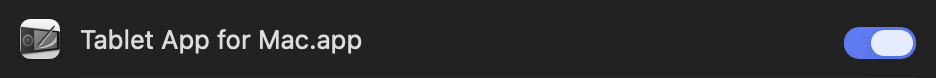

- If the pen draws in Scribble but the pointer doesn't move, Accessibility is missing. Home shows **Open Device Control and Data Access** (called Accessibility on older macOS).
- On **Home**, check the tablet card shows your tablet as connected.
- Open the tablet, choose **Pen** in the Tool row, and set **Tip Feel**.
- Set **Mapping** to the display you draw on.
- Under **Functions**, set the ExpressKeys and the **Touch Ring** modes.
- Your changes are saved by themselves, as with the Wacom driver (Settings › System › **Save changes automatically**, on by default). With that switch off, click **Save** in the footer; unsaved changes are kept and offered again after a shutdown.
- Test in **Scribble**.

## Something doesn't work?

In the app, each answer has a button that does it for you. The buttons are only in the app's own manual.

**My ExpressKeys do nothing.** A key does nothing until you choose what it does. On Tablet › Functions › ExpressKeys, a key with nothing on it says **Not set up**, and Home says how many there are. While the app is in front on the tablet's Pen, ExpressKeys or Touch Ring page, pressing such a key takes you to its card, where a yellow speech bubble says **You just used this. It does nothing yet.** (Version 30: only the key you pressed last shows it).

[Set them up now](app:keys)

**My Touch Ring does nothing.** A Touch Ring nobody has set up gets the four factory modes (Rotate, Zoom, Brush size, Brush hardness) when you open its tablet in the app. The centre button switches between them.

[Open the Touch Ring](app:ring)

**The pen moves on the tablet, but the pointer doesn't.** macOS needs **Device Control and Data Access** (called **Accessibility** on older macOS) turned on for Tablet App for Mac.

[Open Device Control and Data Access](app:pointer)

**The app doesn't find my tablet.** Check it has power and that its USB cable goes straight into the Mac, not through a hub. Then restart the driver.

[Restart the driver](app:driver)

**How do I send a report?** Open the report window, describe the problem, click **Send with file**, then follow the 3 steps on the screen. See Report a problem or send a recommendation.

[Report a problem](app:report)

## Introduction and requirements

Tablet App for Mac sets up a pen tablet on macOS: pen feel, buttons, mapping, ExpressKeys and Touch Ring modes, with per-app settings. Tablet input comes from the tablet driver, built on OpenTabletDriver, which the app starts.

- A Mac with Apple silicon.
- macOS 15 or later (the versions .NET 10 supports: 15, 26 and 27).
- The tablet driver, built on OpenTabletDriver (included in the app).
- Input Monitoring and Accessibility permissions (Accessibility is called Device Control and Data Access on macOS 27).
- Uninstall the Wacom driver first, as both can't run at once.

## Install and first launch

**The two permissions (Input Monitoring and Accessibility) are needed only at the first installation.** The setup window guides you. From Version 18 on, updates keep them: there is nothing to do.

1. Open **Tablet-App-for-Mac.dmg** and drag **Tablet App for Mac** onto the **Applications** folder.
2. Open the app from Applications. The first time, your Mac may say the app was not opened. Click **Done**. Do not click **Move to Bin**.

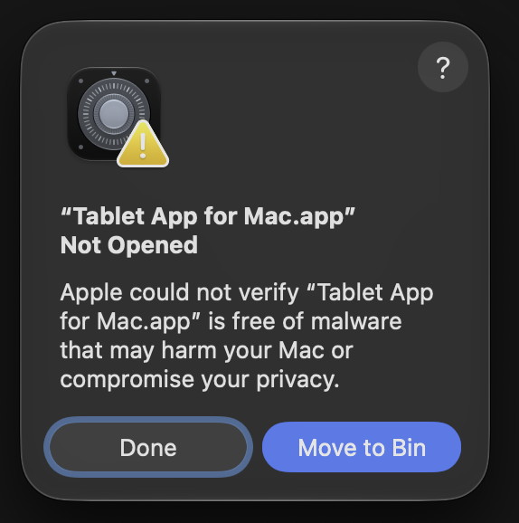

3. Open **System Settings › Privacy & Security** and scroll down to **Security**. Next to "Tablet App for Mac.app was blocked to protect your Mac", click **Open Anyway**.

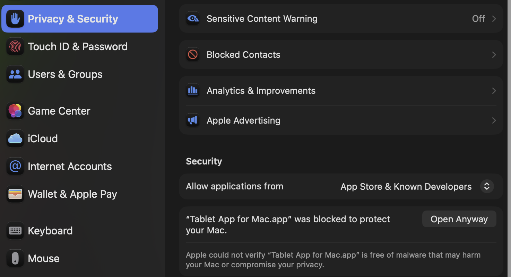

4. macOS asks once more. Click **Open Anyway**. Do not click the blue **Move to Bin** button.

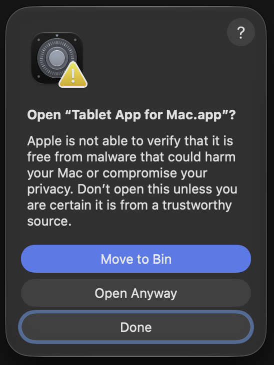

5. Confirm with Touch ID, or click **Use Password…** and enter your Mac login password. The app then opens, and macOS won't ask again.

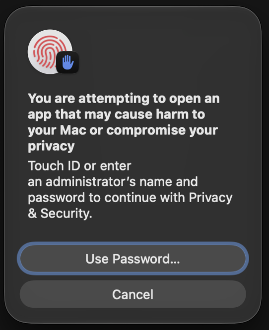

- macOS asks for **Input Monitoring** (to read the pen) and **Device Control and Data Access** (called **Accessibility** on older macOS; to move the pointer and send keys and clicks). Allow both in System Settings › Privacy & Security, then relaunch the app.
- Later, the first time the colour palette sets a colour in Photoshop, macOS asks once more: to let Tablet App for Mac **control Adobe Photoshop**. Click **Allow** (see **Photoshop permission for the colour palette** under Radial menu).
- The app starts its tablet driver. The pen icon stays in the menu bar while it runs.
- To start the app when you log in, switch on **Start automatically when I log in** in **Settings › System** (or add it in System Settings › General › Login Items). At login the app starts silently: only the pen icon in the menu bar shows. Click it to open the window.
- Only one copy runs. Opening the app again brings the running copy to the front.
- To change the language, choose it under **Settings › System › Language**. **Match system** follows your Mac's language.

## Home

- **Setting search** (the box under the tabs, with **Find any setting or function** under it): type what you are looking for, in the app's language. A list shows the matching settings and where they are, for example **Settings › System**. Click one, or press Enter for the first: its page opens and the setting is framed for a moment. Down and Up move through the list; Escape empties the box. Settings of the Tablet page open on the tablet shown there; with no tablet set up, the Tablet page opens without them.
- **Your tablets**: one card per connected or remembered tablet. Click a card to open its settings.
- **No tablet yet?** Click **Choose your tablet**, search for your model (the model number is on the label on the back of the tablet, for example PTK-440) and click **Set up this tablet**, or click **Use a sample tablet**. Every page of that tablet opens, so you can set everything up before you plug it in. Your settings are used as soon as that model is connected. If a different model that this Mac hasn't seen before is plugged in instead, Home offers to copy the pen and screen mapping settings to it (**Copy settings** or **Not now**).
- When a tablet's ExpressKeys have nothing on them, its card shows a big button, for example **6 ExpressKeys not set up: Click this button to choose what they do or restore to factory settings**: click it to go to the ExpressKeys page. The status line under the tablet name says **CONNECTED** in green while the tablet is plugged in. Under it, the smaller red **Forget this tablet** button removes a remembered tablet, or resets a connected one to defaults; it asks first (Version 30: the card's **⋯** menu is gone; open a tablet's settings by double-clicking its card or with the Tablet tab).
- If a remembered tablet is not plugged in, the card tooltip says **Not detected**, and a hint reads **Not found. Double-click to see what to try.** On the tablet page a line says **Not detected. Showing this tablet's saved settings.** The help under it is: if it is plugged in, check it has power and that its USB cable goes straight into the Mac, not through a hub. Then click **Restart driver**. Still not found? **Send a report…**
- Health rows: problems found, each with **Fix** or a specific action where one exists. **Fix** works with the pen even while the pen tip or eraser is disabled.
- **Open driver page**: shown when the driver is not reachable.
- **Check for updates now** and **Earlier versions…**: see Updating.

## Tablet page layout

- **Device**: the selected tablet. The switcher lists connected and remembered tablets. **+** explains how to add a tablet: connect it to your Mac and it appears in the Device row by itself. **−** forgets the selected tablet and its settings (it asks first).
- **Tool**: **Functions** (ExpressKeys, Touch ring), **Pen** (pen, keyboard, mapping), a tile for each extra pen, and **More** (about, calibration, hover, filters, json). **+** explains how to add a pen: bring the new pen close to the tablet and the app adds a tile for it. **−** removes the selected extra pen's settings; the main pen can't be removed.
- **Application**: **All**, or a specific app. **+** adds apps (Command-click to choose several at once). Each added app has its own ExpressKeys, Touch Ring, pen tip and pen button actions. They switch when that app comes to the front, but only once the pen tip is lifted, so a stroke is not interrupted. Mapping and pressure stay the same for every app. **−** removes the selected app's settings; it then uses **All** again.
- **Refresh** reloads the tablet's settings from the driver.
- Footer: **Options…** (Settings), **?** (this manual), **Report a problem or send a recommendation…** (see Report a problem or send a recommendation).

**Typing a value** (Version 29): every slider in the app has a box next to it where you can type the exact value instead of dragging (press Enter or click elsewhere; a value outside the slider's range is set to its nearest end). For example Tip Feel goes from 1 (Soft) to 100 (Firm), 50 being the straight curve, and Settings › Theme › Lightness numbers its 9 levels 1 to 9.

## Tablet › Pen

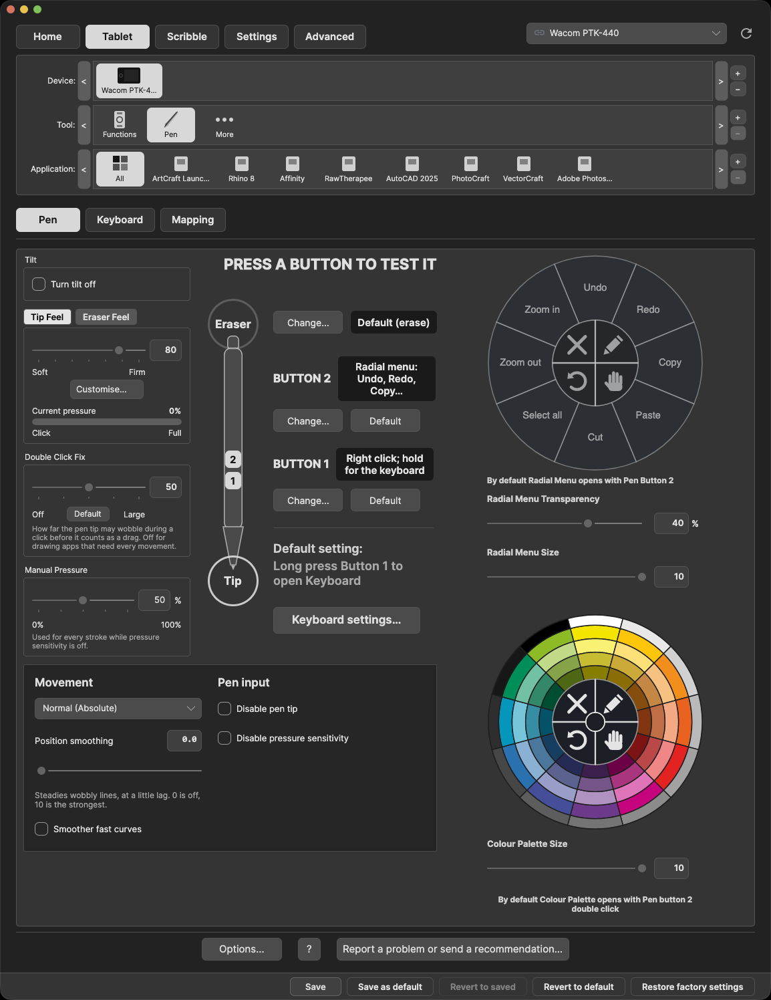

| Control | Default | Function |
|---|---|---|
| Tip Feel / Eraser Feel | Tip Feel | Version 29: the two buttons above the Feel slider choose which end of the pen the page sets up. **Tip Feel** shows the pen tip's settings, **Eraser Feel** the eraser's: the Feel slider and its curve, **Manual Pressure**, **Disable pen tip** or **Disable eraser**, and **Pen input** or **Eraser input**. **Double Click Fix** is for the tip only (its place stays empty while Eraser Feel is chosen). The pen buttons, the radial menu and the colour palette are the same whichever of the two is chosen. |
| Tilt › Turn tilt off | Off | Stops sending tilt. Shared with the eraser. |
| Tip Feel | 80 (Version 29: a new tablet and Restore factory settings); 50 is the straight curve | Soft to Firm pressure curve. A Tip Feel you set yourself is kept when you update. |
| Double Click Fix | 50 | How far the pen tip may wobble during a click before it counts as a drag. Off (0) turns this off for drawing apps that need every movement; Default (50) is 1 mm; 100 is 2 mm. Two tip taps close together still send a double-click. |
| Customise… | Closed | Shows the curve, presets **Soft**, **Linear (no curve)**, **Hard**, the input range sliders and **Cut below input minimum (dead zone)** (off). |
| Eraser Feel | The tip's Feel (Version 29) | The eraser's own pressure curve, set like Tip Feel, with its own **Customise…**. When you update from an older version, the eraser starts with the curve your tip had, so nothing feels different until you change it. |
| Current pressure | Live | Pressure after the curve; tooltip shows the raw value. |
| Eraser and Tip circles | — | The round **Eraser** circle sits over the pen drawing's eraser end and the round **Tip** circle over its point, like a target. The circle of the end you are setting up (**Tip Feel** or **Eraser Feel**) is the brighter one. Next to the Eraser circle: **Change…** and what the eraser end does (**Default (erase)** erases; **Change…** makes it send a key, a mouse button, scroll, the radial menu or, on tablets with finger touch, **Touch on/off**). |
| Button 1 / Button 2 cards (headings in capitals so they catch the eye first) | Default (right click) / **Radial menu** | **Change…** opens the function editor; **Default** puts back the plain default (right click on button 1, middle click on button 2). Under **Mouse** you can choose **Double Click** (posts a left-button double-click at the cursor). **Radial menu** is the starting setting of pen button 2 on a new tablet and after **Restore factory settings**: press that button and a round menu opens under the pen (see Radial menu below). Choose something else under **Change…** to use button 2 for that instead. |
| Radial Menu Settings | Picture of the radial menu | On the right of the pen page (the pen drawing and the Button cards are next to it), always shown. **Click the picture** to open the radial menu editor (the one menu every application uses, see Radial menu; the menu of the pen button that opens it). Under the picture, a line says which button opens it: **By default Radial Menu opens with Pen Button 2**, or **Radial Menu opens with Pen Button 1** once you have chosen another button. If no pen button opens the radial menu, the picture is dimmed and says **No pen button opens the radial menu**; **Use pen button 2** makes button 2 open it (button 1 on a pen with one button). Pressing a pen button to test it works as before: its number lights on the pen picture and the line above the cards names it. Under the picture: **Radial Menu Transparency** and **Radial Menu Size**, each a slider with a number box you can type in; the picture shows both live. The picture is the menu at its **real size**, so the menu your pen opens is exactly as big as the picture (in a very narrow window the picture is shrunk to fit). **Click one of the four centre icons** in the picture (×, pencil, circular arrow, hand) to read what that button does in the real menu; it doesn't open the editor. |
| Colour palette picture | Under the radial menu picture | Version 29: the colour palette at its size, with **Colour Palette Size** under it, and a line saying how it opens: **By default Colour Palette opens with Pen button 2 double click**, or **Colour Palette opens with Pen button 1 double click** when you chose button 1 for the radial menu. |
| Pen button test | Live | The line above the pen drawing reads **PRESS A BUTTON TO TEST IT**. Press a barrel button: its number on the pen picture lights while held, and the line reads "BUTTON 2 PRESSED." (or 1). |
| Default setting / Keyboard settings… | Shown under the Button cards | Version 29: "Default setting: Long press Button 1 to open Keyboard" (shown while holding pen button 1 opens the keyboard), and the **Keyboard settings…** button, which opens the Keyboard tab. "Pen tip" is the label under the pen drawing; the pen tip's own line (with **Fix**) appears only when the tip is not on its default. |
| Movement | Normal (Absolute) | **Normal (Absolute)** maps the pen to the screen. **Relative (slow / no mouse-like speed-up)**: the pointer moves from where it is, by how far the pen moves. No Mac-style speed-up. Both choices are always shown, and a saved Relative setting is never changed for you. Clicks, click-drags and a button set to **Double Click** happen at the pointer, as with a mouse. Relative mode also uses the tablet rotation set under Mapping. |
| Position smoothing | 0.0 | Steadies the cursor, with some lag. The slider is under its name and runs from 0 (off) to 10 (strongest, the old 0.25); the number is shown next to the name. |
| Smoother fast curves | Off | Adds smooth in-between pen points, so fast curves don't show flat pieces in drawing apps that join points with straight lines. About 5 ms of extra delay. New in Version 26. |
| Disable pen tip | Off | The tip makes no strokes; the bar reads 0%. |
| Disable pressure sensitivity | Off | Every stroke uses the Manual Pen Tip Pressure while pressed, in every app. |
| Manual Pressure | 50% | Own frame under the Feel slider (the tip's or the eraser's, as chosen with Tip Feel / Eraser Feel). The pressure used while pressure sensitivity is off (0 to 100%). |

**Extra pens:** each pen you use on the tablet gets its own tile in the Tool row, with its own tip, eraser and side-button settings (a copy of the main pen's to start with). Tip Feel, pressure, tilt and mapping are shared by all pens.

## The eraser

Version 29: there is no separate Eraser tab any more. Click **Eraser Feel** on the Pen tab to set up the eraser (see Tablet › Pen above). Separate for the eraser: its Feel curve, **Disable eraser** and its **Manual Pressure**. Shared with the pen tip (the same setting whichever of Tip Feel or Eraser Feel is chosen): tilt, pressure sensitivity, Position smoothing and Movement. The pen buttons are the same for both ends.

When you turn the pen over, the app tells macOS that the pen tip has left before the eraser arrives, as a Wacom pen does, so apps that give the eraser its own tool (GIMP, for example) can switch to it.

## Tablet › Keyboard

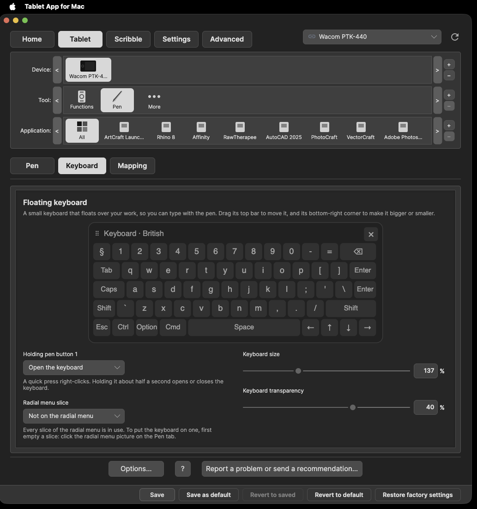

The **Keyboard** tab (Version 29, between Pen and Mapping) holds the **Floating keyboard**: a picture of the keyboard at its size and transparency, in your Mac's keyboard layout; **Holding pen button 1** (**Open the keyboard** is the factory setting; a quick press still right-clicks); **Radial menu slice** (put the keyboard on an empty slice of the radial menu, or **Not on the radial menu**); **Keyboard size** and **Keyboard transparency**, each a slider with a box you can type in. On the Pen tab, the **Keyboard settings…** button under the Button cards opens this tab. See **Floating keyboard** under Radial menu for how the keyboard works.

## Tablet › Mapping

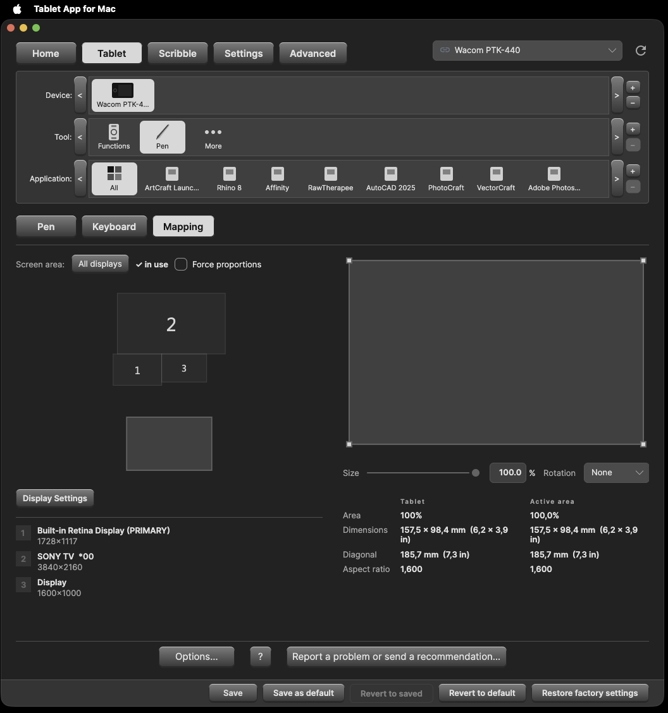

| Control | Default | Function |
|---|---|---|
| Active area | Whole tablet | Drag the area or its corners. |
| Rotation | 0° | 180° puts the ExpressKeys on the other side; 90° and 270° are portrait. This rotation is also used in Relative (slow / no mouse-like speed-up) mode. After rotating, recalibrate (More › calibration) if the pointer no longer sits under the nib. |
| Display / All displays | Main display | The display the area maps to. |
| Force proportions | On | Keeps the area at the display's aspect ratio. |
| Display Settings | – | Opens macOS Displays settings. |

## Tablet › Functions › ExpressKeys

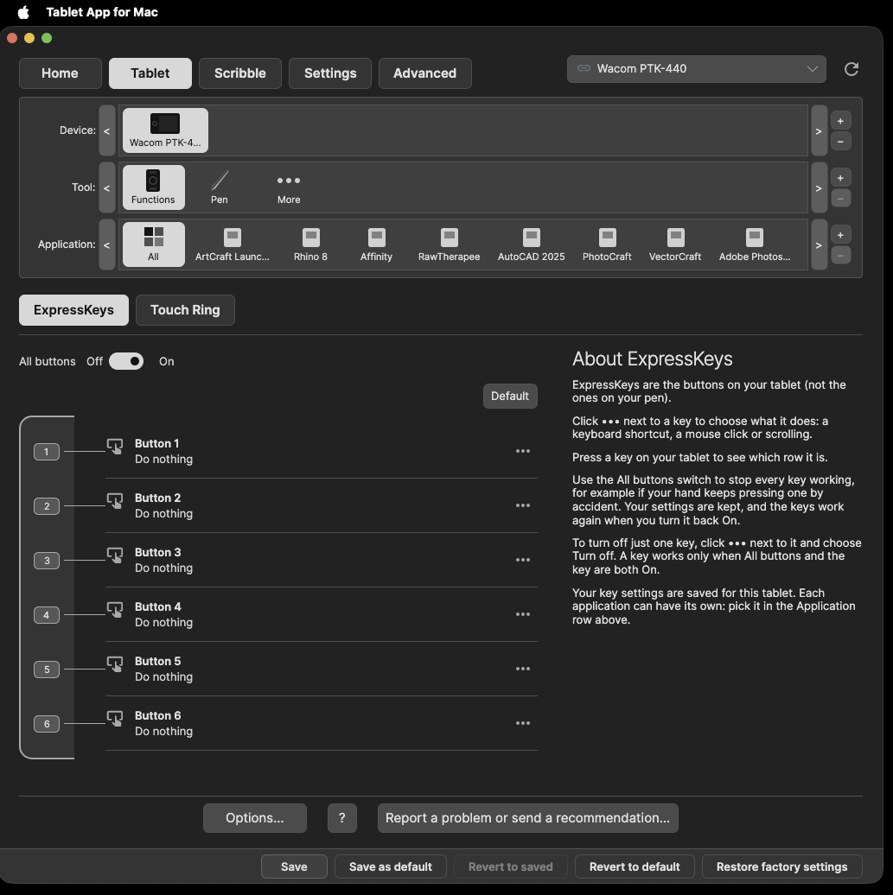

- Press a key on the tablet to light its row.
- Row **⋯**: **Edit…** opens the function editor, **Clear** removes the action, **Turn off** / **Turn on** switches just that key (an Off key is greyed and keeps its shortcut). Each application keeps its own On/Off for every key.
- **All buttons** (Off / On switch) turns every ExpressKey off or on; actions and each key's own On/Off are kept. A key works only when **All buttons** and the key are both On. While **All buttons** is Off, the per-key item is greyed ("Turn on All buttons first").
- **Default**: clears every ExpressKey action, after asking.

Function editor: **Keyboard** (a shortcut; Cmd, Ctrl, Shift and Option are held modifiers), **Mouse** (Left click, Right click, Middle click, Back button, Forward button, or **Double Click**), **Scroll** (up, down, left, right, or a pen gesture), **Media** (Mute, Volume down, Volume up, Play / Pause, Previous track, Next track, Stop, and since Version 29 **Brightness down** and **Brightness up**, which work like the Mac's own brightness keys: they change the screen of the window you last clicked in, and with Control held the other screen (from the Mac's own screen an external one, from an external screen the Mac's own), as the Mac's keyboard does; a screen the Mac's own keys can't dim won't change either; set them on the Touch Ring's Clockwise and Anticlockwise to turn the brightness with the ring). **Radial menu** is on its own tab (see Radial menu). **Save**, **Cancel**, **Clear**.

Pen gestures under **Scroll**, each with a **Speed** slider (Slow to Fast, 1–100, default 50):

- **Move pen to scroll**: hold the button and move the pen to scroll like a mouse wheel; the cursor stays still and the tip does not click.
- **Move pen to zoom**: hold the button and move the pen up or down to zoom. Uses Option+scroll, like the Touch Ring Zoom mode. Works in Photoshop and Affinity.
- **Move pen to pan and zoom**: hold the button and move the pen: sideways to pan, up or down to zoom. Works in Photoshop and Affinity.

### Radial menu

A pen button or an ExpressKey can open a radial menu, like the one in Wacom's driver: a round menu with 8 slices, centred on the pen. **Pen button 2 opens it from the start** on a new tablet, so you can try it at once: press button 2 and tap a slice.

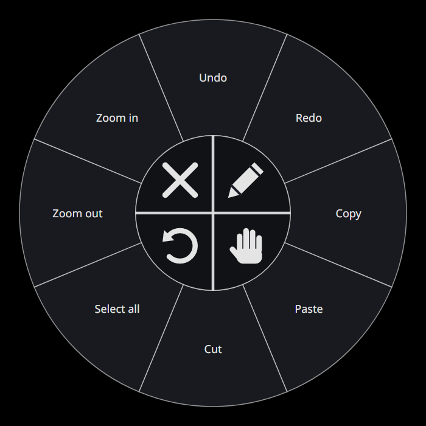

- Set it up: **Change…** on a pen button or an ExpressKey, then the **Radial menu** tab, **Save**. **Edit menu…** opens the menu editor. The Pen page also has a shortcut: **Radial Menu Settings** (see Tablet › Pen).
- Use it: press the button, then tap a slice with the pen tip. Since Version 29 the menu **stays open** until you close it, so you can tap several slices one after another (for example Undo three times). A tap outside the menu goes to your work as usual, and an empty slice does nothing. To close it, tap the **×** in the centre, press the button again or press **Esc**; nothing else closes it, and it never closes by itself. A pen tap on the menu never draws in your app. A **Mouse click** slice lets its click through the menu to your work for a moment; the menu stays where it is.
- The **centre** has four buttons, each with its own highlight under the pen or the pointer: **× (top left)** closes the menu. **Pencil (top right)**: tap it, then tap a slice, and choose what that slice does from the same choices as **Edit menu…**; the change is saved at once and the menu stays open (tap the pencil again to put it down). **Circular arrow (bottom left)** asks "Restore the 8 default slices?": tap **Yes** (right) or **No** (left). **Open hand (bottom right)**: press it with the pen tip or the mouse and move more than a few points to drag the menu somewhere else; a press that doesn't move does nothing. A menu you have moved stays until you close it.
- With the **Mac mouse**: click a slice to run it in the app underneath; the menu stays open, so you can open it with the pen and then use your 8 commands with the mouse. Click the **×**, or press **Esc**, to close it. Slices that click the mouse need the pen. The menu does not take the keyboard from your drawing app.
- **Edit a slice**: tap the **pencil**, then tap a slice (with the pen **or** with the Mac mouse) and its editor opens. While you are choosing, the hint **Edit the slice you tap next** is shown next to the menu (under it) and stays until you pick a slice or tap the pencil again; it no longer appears over the app you are working in.
- **Confirmation**: when a slice runs, a short text appears for a moment under the menu (above it if the screen is full): for example **Selection copied**, **Undone**, **Pasted**, **Zoomed in**. Slices you made yourself say **{name} done**. If the action did not work, it says **{name} did not work** (and the reason is in the app log). The text never takes the keyboard or the mouse; it is in the app's language.
- In **Scribble**, the radial menu's **Undo** and **Redo** undo and redo your strokes (so does **Cmd+Z** and **Cmd+Shift+Z**), so you can try the menu without a drawing app. **Copy** copies the drawing; Paste, Cut, Select all and Zoom only say that they work in your drawing app.
- Menu editor: click a slice, give it a **Name** and choose **What it does**: **Keystroke** (**Set keystroke…**), **Mouse click** (Left, Right, Middle or Double Click), **Submenu** (8 more slices; **Edit submenu** opens it, up to 3 levels), **Open an app** (**Choose app…**), **Show or hide the keyboard** (see **Floating keyboard** below), or **Nothing** (the slice does nothing). **Clear slice** empties one slice, **Reset menu** brings back the starting menu (Undo, Redo, Copy, Paste, Cut, Select all, Zoom out, Zoom in). **Menu size**: Small to Large (1 to 10). Move the slider, or click the number box next to it and type a size (press Enter or click elsewhere; Up and Down change it by 1). Large is the biggest the menu gets, 320 points across; a menu saved with an older, larger size is shown and used at Large. The ring on the left changes size live while you move the slider, so you see how big the menu will be. The editor fits the window: in a small window the ring becomes smaller instead of being cut off, and nothing hides behind the size and transparency rows. **Menu transparency** (0 to 60%, 0 is solid) makes the whole menu see-through, names and icons included, so you can see your work behind it: 40% unless you change it. It stops at 60% so the slice names stay readable even over a white page. A menu that is already open on screen changes at once while you move the slider. Move the slider or click the number box and type a value (press Enter or click elsewhere; Up and Down change it by 1), and the ring on the left shows it live. The short texts next to the menu (the pencil hint, "Selection copied") are always solid. **Reset menu** puts back the starting menu, size 10 and transparency 40%.
- **Floating keyboard** (Version 29): a small keyboard that floats over your work, so you can type with the pen, for example a layer name or a number. Open or close it by **holding pen button 1** for about half a second (the factory setting; a quick press still right-clicks), or give a radial menu slice **Show or hide the keyboard** (the **Keyboard** tab does both, see Tablet › Keyboard). It opens **under the pen** every time, on the screen the pen is on. Its keys follow the keyboard layout chosen in the Mac's menu bar (for example **British** or **Bulgarian**) and the shape of your Mac's keyboard, like the Mac's own Keyboard Viewer: each key shows what it types, letters in small type until you tap **Shift** or **Caps Lock**, and the keyboard's title says which layout it follows. Switch layouts and the keys change within a second. Tap a key with the pen (or click it with the mouse) and it goes to the app you are working in; the keyboard never takes the keyboard focus from it. **Ctrl**, **Option**, **Cmd** and **Shift** turn blue and apply to the next key only (tap **Cmd**, then **Z**, for Undo); **Caps Lock** stays on until you tap it again. Drag the bar at the top to move it, and its bottom-right corner to make it bigger or smaller. Close it with its **×**, by holding pen button 1 again or by tapping the slice again. **Keyboard size** (60 to 300%) and **Keyboard transparency** (0 to 60%, 40% after Restore factory settings) are on the Keyboard tab. What you type is never written to the app log.
- **Colour palette** (Version 29): press the pen button that opens the radial menu **twice quickly** and a colour wheel opens where the pen is: 12 colours round the wheel, each pure, light, muted and dark towards the centre, and a ring of greys from white to black round the outside. The radial menu and the palette can be open at the same time (new in Version 29): one press opens or closes the menu, two quick presses open or close the palette, and if one would cover the other it opens beside it. The **×** closes the one it is on; **Esc** closes both. Tap a colour: in **Photoshop** it becomes the foreground (brush) colour at once (the first time, macOS asks to let Tablet App for Mac control Photoshop: click **Allow**, see **Photoshop permission** below); in every app the colour's code (for example #E32322) is copied, so you can paste it into a colour box, and a short text next to the palette says what happened. The palette is always solid, so you can also pick its colours with an app's own eyedropper (in Photoshop, start the drag in your picture and let go over the palette; Photoshop needs Screen Recording permission for that). The centre works as on the radial menu: **pencil**, then a colour, to change it to your own colour; **circular arrow** puts the palette's own colours back (after a Yes / No); **open hand** drags it. The **small circle in the middle** shows the last colour you picked from the palette, also the next time you open it (it can't know about a colour you change inside Photoshop another way); tapping it does nothing. On the Pen page, under the radial menu picture, the colour palette picture shows your colours, with **Colour Palette Size** under it; an open palette changes size as you move the slider.
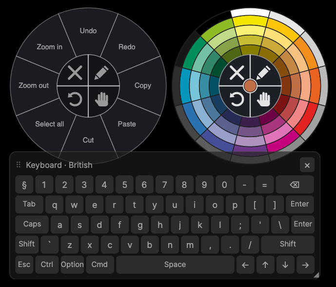

- **Photoshop permission for the colour palette** (Version 29): the first time you tap a colour while Photoshop is in front, macOS shows "Tablet App for Mac.app wants access to control Adobe Photoshop", with the line "The colour palette sets the colour you tap as the foreground colour in Photoshop." Click **Allow**. The app only uses this to set the foreground colour; it doesn't open, read or change your documents. If you clicked **Don't Allow**, the colour's code is still copied, but Photoshop's colour doesn't change: turn it on in **System Settings › Privacy & Security › Automation**, under **Tablet App for Mac**, switch on **Adobe Photoshop**.
- **Floating keyboard in one click**: on the **Keyboard** tab, choose an empty slice in **Radial menu slice**; the keyboard goes on that slice at once (and **Not on the radial menu** takes it off again).
- **One radial menu and one colour palette for every application** (since Version 29): whichever application is in front, and whichever tile is chosen in the Application row, the pen opens the same menu and palette, and every change (the editor, the pencil, **Menu transparency**, **Menu size**, **Palette size**, your own colours) changes them everywhere at once. Each application can still give the pen buttons other jobs; a button set to **Radial menu** in any application opens this one menu. The menu is saved with your tablet settings, so Save, Save as default, Revert and the settings backup include it. (Before Version 29 an application's settings could hold their own copy of the menu; the first time you open the Pen page after updating, those copies are replaced by the menu of **All**.)
- **Settings › System › Radial menu** switches every radial menu off or on (on by default). A new tablet and **Restore factory settings** start with the Radial menu on pen button 2.
- New in Version 26 and not yet tried on a real Mac.

## Tablet › Functions › Touch ring

- **Touch Ring** (a tablet with one ring), **Touch Rings** (two rings, for example Cintiq 24HD), or **Touch Strip** / **Touch Strips** (tablets with touch strips, for example Intuos3 or Cintiq 22HD): an Off / On switch, On. Off pauses the ring or strip actions without deleting them. With two rings or strips, each one also has its own Off / On switch next to its name; it works only while the main switch is On, and the main switch never changes it.
- **One switch, one menu** (since Version 29): the **Touch Ring** switch above is the only one. Every ring has up to four modes; the factory ones are Rotate, Zoom, Brush size and Brush hardness (see **Default** below). The old **Touch Ring modes** switch and the plain Clockwise / Anticlockwise rows are gone. A ring that used the plain rows moves into **mode 1** by itself, with the same keys and the same centre button, so it keeps doing what it did.
- **Centre button**: its own menu, next to the ring. **Next mode** (the factory choice) switches between the modes and the on-screen display shows each one. **Do nothing** turns the centre button off. **Keyboard shortcut…** shows a box: click it and press the keys. Or pick a click (**Left**, **Right**, **Middle**, **Double Click**) or a **Media** key (Mute, Volume, Play / Pause, tracks, Brightness). With anything but **Next mode**, nothing switches the modes, so the ring always does what **mode 1** is set to and modes 2 to 4 are dimmed. The line under the menu says what the ring does.
- **Show touch ring setting (on-screen mode display)**: shows the mode name when you switch.
- The dial follows the ring live: the dot sits under your finger. The angle and turn direction show under the ring, for example "0° · Clockwise". 12 o'clock is 0° and 3 o'clock is 90°.
- The active mode is highlighted; its number is lit, centred, and also shows on the centre button.

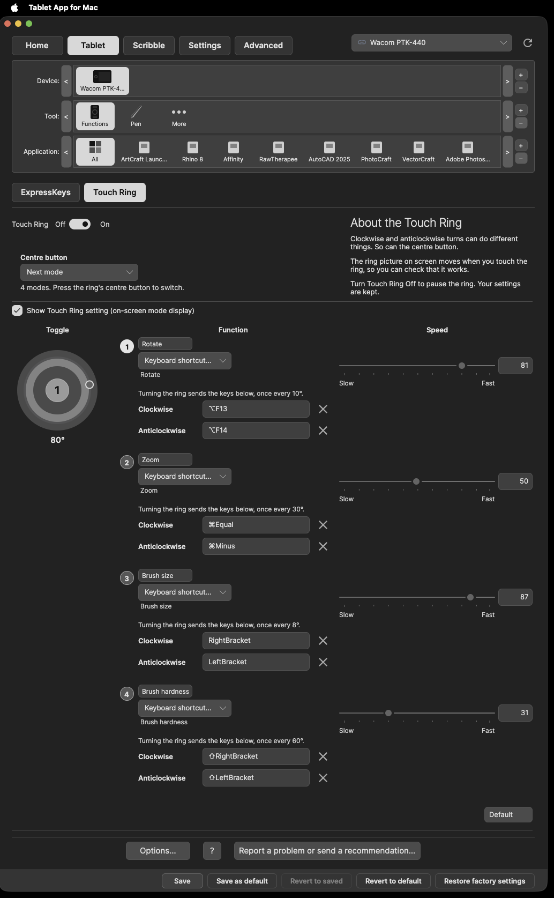

- On-screen centre button: moves the highlight to the next mode so you can edit it; it doesn't change the mode the tablet uses. Only the tablet's own centre button switches the mode.
- Per mode: name, **Function**, **Speed** (Slow to Fast, slider or typed), and the **Clockwise** and **Anticlockwise** keys. The **Function** menu: **Keyboard shortcut…** (click the box next to **Clockwise** or **Anticlockwise** and press the keys; **Backspace** or **×** empties it; no window opens), the experimental smooth actions, **Scroll**, **Volume**, **Brightness**, **Previous / next track** (ready to use: pick one and the ring turns it up and down), and, last, **Do nothing**: the ring does nothing in that mode and the centre button skips it (it replaces the old **On** tick box). Shortcuts the Mac keeps for itself, such as ⌘Q, can't be typed into a box.
- **Speed**, the same scale for every function: 1 acts once every 180° of ring, 50 about every 30°, 100 on every ring step. For **Smooth rotate**, **Smooth brush size** and **Smooth hardness** in Photoshop, the Speed sets how far the canvas turns or the brush changes.
- Where the smooth actions work: **Smooth rotate**, **Smooth brush size** and **Smooth hardness** in Photoshop; **Smooth zoom** (Option + scroll wheel) in Photoshop and Affinity; **Smooth rotate** in Affinity uses ⌘ + scroll wheel, so first turn on **Enable canvas rotation with ⌘+scroll wheel** in Affinity's **Settings › Tools**. In any other app, a smooth mode sends its **Clockwise** and **Anticlockwise** keys at its Speed. If Photoshop moves the canvas up and down instead of zooming, untick **Zoom with Scroll Wheel** in Photoshop's **Settings › Tools**, or use **Keystroke** with ⌘= / ⌘−.
- **Scroll** scrolls like a mouse wheel in every app: clockwise scrolls down, anticlockwise scrolls up (as on Wacom's driver). The Speed sets how often it scrolls: 70, the default, is about one wheel notch every 15° of ring.
- With an app selected in the **Application** row, the ring settings you change are that app's. Select **All** to change them for every other app.
- Coming from Version 16 BETA 1 or earlier: the ring modes ran backwards there (a clockwise turn zoomed out). The app turns them the right way round when it opens; click **Save** once to keep it.
- **Default** restores the four modes and sets the centre button to **Next mode**:

| Mode | Clockwise | Anticlockwise | Every |
|---|---|---|---|
| Rotate | Option+F13 | Option+F14 | 10° |
| Zoom | Cmd+= | Cmd+− | 30° |
| Brush size | ] | [ | 8° |
| Brush hardness | Shift+] | Shift+[ | 60° |

**Touch strips** (Intuos3, Cintiq 21UX, Cintiq 12WX and Cintiq 22HD; new in Version 16, not yet tested on these tablets): the page shows each strip, **Touch strip** or **Left touch strip** and **Right touch strip**, with an **Up** and a **Down** row instead of the ring. Slide your finger up or down the strip to send that row's keys. Strips have no centre button, so they have no ring modes.

## Tablet › More

- **about**: the tablet's model and features: digitiser resolution, pressure levels, pen buttons, **Tablet buttons** and wheels.

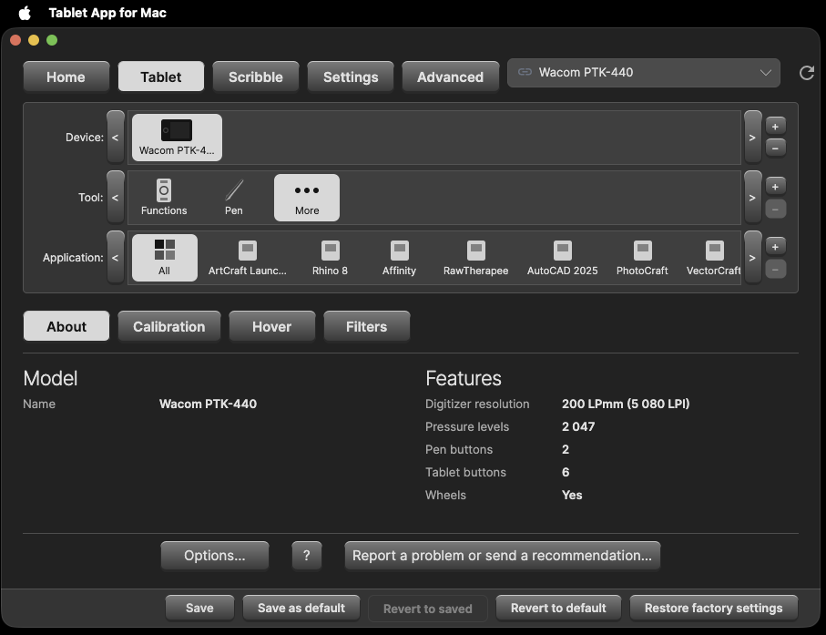

- **calibration**: **Start** shows full-screen targets; tap each, then **Apply**. **More calibration actions**: **View report…**, **Export calibration…**, **Import calibration…**, **Clear calibration**. The on/off switch turns the calibration correction off and on, so you can compare. Calibrate only if the pointer sits away from the nib.
- **hover** (below): hover limit, off by default; 127 when first switched on (0 to 255). The pen stops moving the cursor when it is higher above the tablet than this limit.
- **filters**: filters from other OpenTabletDriver plugins on this tablet, for example **Antichatter** or **Radial Follow** smoothing, which can calm a shaky pointer. Each filter has an **Off** / **On** switch (Off on the left, On on the right). Turn one on to use it with this app; if the pen starts to feel odd, turn it off again. A filter you turn on is remembered and is not switched off by the app. For simple smoothing while the pen touches, try **Pen › Position smoothing** first. If the profile has no filters, the page says **No filters configured**. A **Legacy** mark means a leftover from an older plugin: it has no effect and is removed automatically. New in Version 26.
- **json**: the profile as the driver stores it.

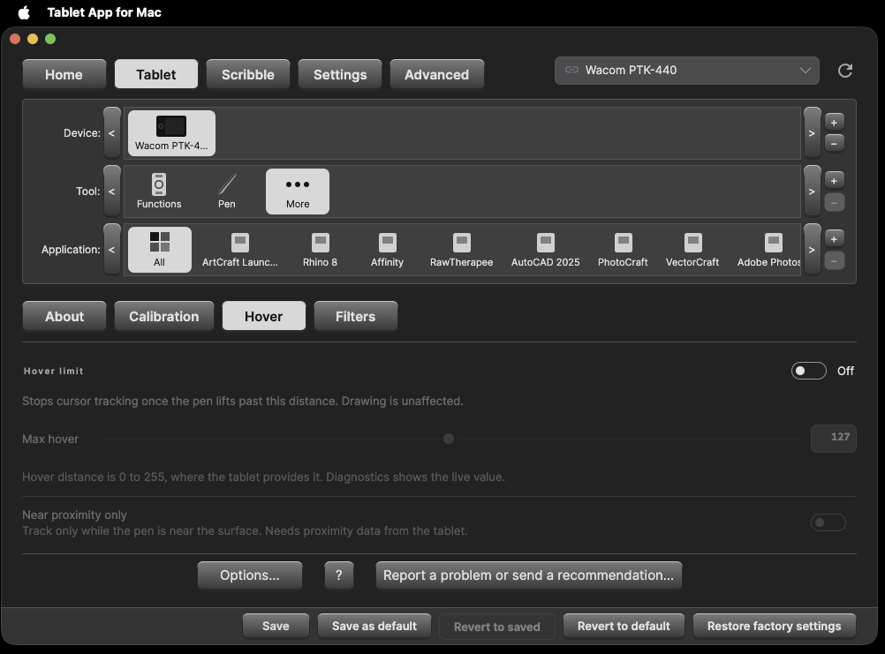

## Finger touch (Intuos Pro M PTH-651; Bamboo Pen & Touch CTH-460, CTH-461, CTH-661)

On these tablets finger touch works like a Mac trackpad. Switch it on or off with **Touch trackpad** on **Tablet › More › About**. On the PTH-651 it starts on; on the Bamboo Pen & Touch models it starts off.

**Touch on/off key**: set a pen button, the eraser or an ExpressKey to **Touch on/off** (**Change…** › **Touch**; the tab is only there on tablets with finger touch). Each press turns finger touch on or off, like Wacom's Touch On/Off. Changing the **Touch trackpad** switch sets touch again.

- One finger moves the pointer.
- Two fingers scroll.
- Tap to click. Two quick taps double-click.
- Tap, then touch again and move to drag. Lift your finger to let go.
- Tap with two fingers to right-click.
- A held click is released when the driver stops the touch filter (for example when the tablet is unplugged).

Touch is ignored while the pen is near the tablet, so a resting hand doesn't move the pointer.

Under the **Touch trackpad** switch:

- **Touch speed** (1 to 100): how far the pointer goes when one finger moves. 50 is the speed of Version 28; higher is faster.
- **Scroll momentum** (off at first): two-finger scrolling keeps going for a moment after you lift your fingers, then slows to a stop, like a Mac trackpad. Touch the tablet, or use the pen, to stop it.

## Scribble

A test canvas with a precise crosshair cursor. If the canvas says "Drawing is off because the pen isn't set to follow the screen", click **Use pen on screen**: Movement becomes **Normal (Absolute)** and, if needed, the pen is mapped to all displays. The same settings are in **Tablet › Pen › Movement** and **Tablet › Mapping**. Draws with the processed pressure, so the curve, Disable pen tip and the Manual Pressure are visible.

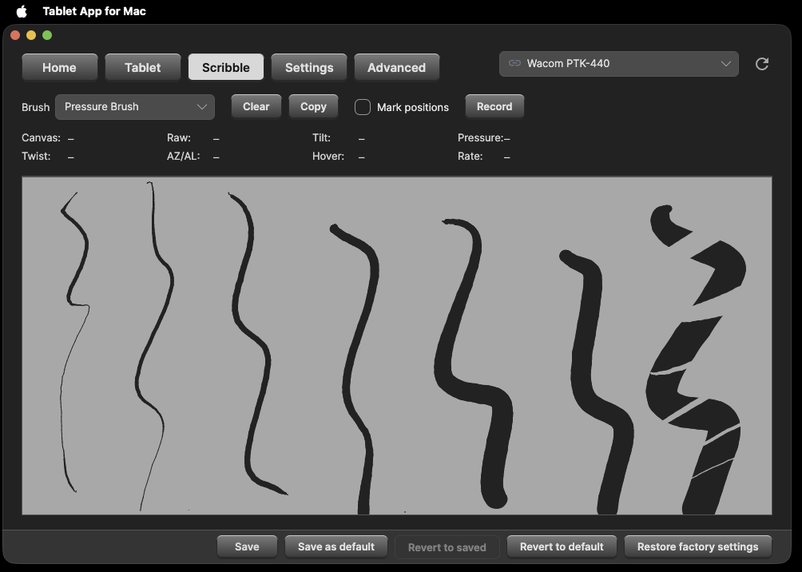

**Mark positions** draws a dot for each position the tablet reports. **Clear**, **Copy**. **Cmd+Z** undoes the last stroke (or a Clear) and **Cmd+Shift+Z** does it again; the radial menu's Undo and Redo send the same keys. **Record** and **Stop** save a stroke recording.

## Settings

- **Theme**: **Themes** (Graphite, Silver, Charcoal, Rose, Burgundy, Custom, System; default Graphite), brightness, **Backdrops** (Solid colour, Generated gradient, **Add glow**, **Choose image…**), **Colours** (Highlight colour, Card colour). **Reset to defaults**.
- **Hotkeys**: global shortcuts for tablet actions and **Load a preset**. **Assign…**, **Clear**. Default: not set.
- **Presets**: see Presets and saving.
- **System › Status light** (shown only while an Intuos4 is connected): **Light up the status light when the pen touches** is on by default. The tablet's status light stays dim and gets bright while the pen touches, as it did with the Wacom driver. Switch it off for one steady brightness. The setting is sent to the tablet once when it connects, not while you draw.
- **System › ExpressKey screens** (shown only while an Intuos4 Medium, Large, Extra Large or Wireless is connected by cable): **Show what each ExpressKey does on its screen** is on by default. Each small screen beside an ExpressKey shows that key's action, for example "Shift Cmd / Z" or "Right click". A key that does nothing stays dark. The words follow your settings, including per-app settings. Switch it off and the screens stay dark. New in Version 26 and not yet tried on a real tablet with screens.
- **System › Saving**: **Save changes automatically** is on by default. Every change is kept at once, also after a restart, as with the Wacom driver. That includes a preset loaded with a hotkey and the display a hotkey switches to. Changes kept from the last time the Mac shut down are not saved by themselves: keep them with **Save** or drop them with **Revert to saved**. Off: changes still work at once, but only **Save** keeps them.
- **System › Radial menu**: **Show the radial menu** is on by default. It is for pen buttons and ExpressKeys set to Radial menu (see Tablet › Functions › ExpressKeys › Radial menu). Off: those buttons do nothing.
- **System › Settings backup**: **Export settings…** saves all your settings in one file: tablets, pens and per-pen settings, presets, applications, Touch Ring modes, calibration and app settings. The suggested name is the tablet model and the date, for example `Intuos4PTK440_30Oct26.tabletsettings` (`TabletApp_30Oct26` when no tablet is connected); you can type another name. Serial numbers and your user name are left out, so you can email the file to someone else or keep it for a new Mac. **Import settings…** opens a file and lists what would change (**New**, **Changed**, **Same**) before anything happens; click **Apply these settings** or **Cancel**. Your current settings are backed up first. Then quit and reopen the app.
- **Settings files in Finder**: a `.tabletsettings` file shows the app icon on a page. Double-click it to open Tablet App for Mac at **Settings › System** with its Import preview; nothing changes until you click **Apply these settings**.
- **App menu**: the **Tablet App for Mac** menu at the top left of the screen has **About Tablet App for Mac** (opens Home, with the version and links), **Report a problem or send a recommendation…** (see Report a problem or send a recommendation), **Export settings…** and **Import settings…** (the same as the buttons in Settings › System; results show in the main window). The pen menu in the menu bar has them too.
- **System › Automatic backups**: when a new version starts for the first time, the app backs up all your settings by itself, and it does the same before every import. The last 5 are kept. **Preview…** shows what bringing one back would change; **Show in Finder** opens the folder.
- **System › Diagnostic file**: **Create diagnostic file** saves one zip on your Desktop with a summary (app, driver and macOS versions, connected tablets, other tablet drivers found, and your mice and keyboards: name, IDs, connection and driver), the app and driver logs and your settings. Serial numbers, Bluetooth addresses and your user name are removed. The path shows under the button; attach the zip to a GitHub issue. The same button is on **Settings › Troubleshooting** (**Diagnostic report**) and on **Advanced › Diagnostics**.
- **System**: **Start at login**. Switch on **Start automatically when I log in** to have the app start by itself when you log in to your Mac, with only the pen icon in the menu bar. If it is off and macOS reopens the app after a restart, the app opens its window as usual. In the first minute after login a second click on the app always shows the window. **Open Login Items…** opens the same setting in macOS: System Settings › General › Login Items.
- **Troubleshooting**: a page under Settings with quick fixes when the tablet stops responding, a setting will not stick, or you need to send a report. **Restart driver** stops the tablet driver and starts it again; use this when the pen stops moving or a tablet is not detected. **Diagnostic report** has **Create diagnostic file** (the same zip as **System › Diagnostic file**; **Show in Finder** appears once it is saved). **Reset permissions** clears this app's Input Monitoring and Accessibility entries so macOS will ask again.

## Advanced

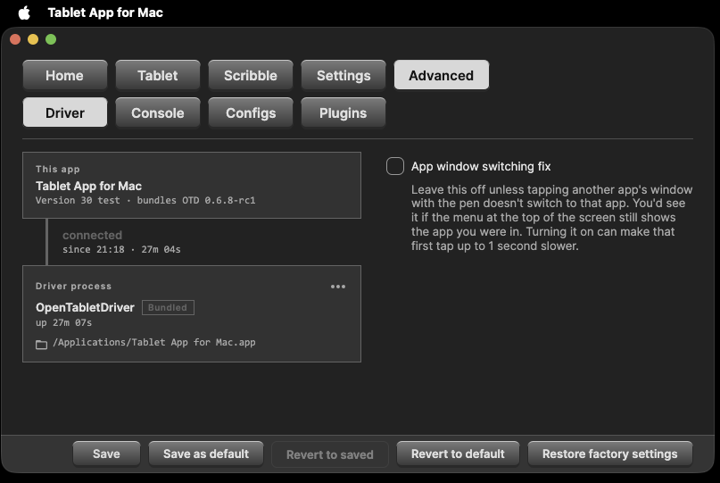

- **Driver**: the **Driver process** card, with **Start**, **Restart** and **Stop** in its **⋯** menu; **Open OpenTabletDriver's own window**; **Open the folder holding this driver**.
- **Plugins**: **Rescan plugin folder**, **Open plugin folder**.
- **Configs** (tablet configs): **Check for more configs**, **Install**, **View**.
- **Console**: severity filter, text filter, **Auto-scroll** (on), copy as text, Markdown or HTML, **Clear**.
- **Diagnostics** (shown when **Settings › Dev** turns it on): **Start** and **Stop** live reports, and **Create diagnostic file**.
- **App window switching fix** (on **Driver**, Mac only, off at first): leave it off unless tapping another app's window with the pen doesn't switch to that app (the menu at the top of the screen still shows the app you were in). Turning it on can make that first tap up to 1 second slower.

## About and Options

**About** shows the version and links: **Get help** (report a bug, ask a question or send feedback on GitHub), **Supported tablets**, **Source code**, **Releases**, **User manual**, **Credits and licences**, **Feedback** (opens Report a problem or send a recommendation, below). **Options…** opens Settings.

## Report a problem or send a recommendation

You can open the same report from three places:

- the app window: **Feedback** on **Home**, or **Report a problem or send a recommendation…** at the bottom of the Tablet page;
- the pen icon menu in the menu bar (top right);
- the **Tablet App for Mac** menu (top left).

The report opens inside the app window:

- **How to report** (at the top) shows a short guide: click **Record the problem**; make the problem happen 3 to 5 times, a few seconds apart; if it is about clicks, click the same windows with your mouse first, then with the pen; click **Stop recording** within 2 minutes; in one line, write what you expected and what happened instead; click **Send with file**, then follow the 3 steps on the screen.
- Choose **A problem** or **A recommendation**.
- Write what happened, or your idea (you can leave it empty).
- A picture of the app window, as it was just before the report opened, is added. Untick **Add this picture of the app window** to leave it out. **Add screenshots…** adds more pictures (up to 10 in all).
- **Record the problem**: click it, make the problem happen with your tablet (pen, eraser, buttons, touch, ExpressKeys or touch ring), then click **Stop recording**. The report then also holds what the tablet sent in those seconds (up to 2 minutes), and the app and driver logs are marked where the recording started and stopped. On a Mac it also records every click and mouse event macOS sees, from the mouse and from the pen, and how long each click took to bring its window and app to the front, so a mouse click and a pen click on the same windows can be compared.
- Press **Send with file** or **Send with GitHub account**. Both make one file with your text, your pictures and the app and driver logs. Serial numbers and your user name are removed from the logs. Pictures are sent as they are, so check them first.
- **Send with file** needs no account. It asks where to save the file (the Desktop is suggested). Then the report shows 3 numbered steps:
  1. Click **Open upload page**. A web page opens in your browser, and Finder shows your report file. If the page doesn't open (no internet, or the page is blocked), click **The page doesn't open?** under the button: the report shows our email address with **Copy address**. Email the report file to us instead.
  2. On that page, click **Add files** and choose your report file. The report shows the file's name and folder; you can also drag the file from the report straight onto the page.
  3. Type any name and your email, then click **Upload**. Only the Tablet App for Mac team sees them. You don't need an account.

  The steps stay on screen until you click **Done**. Your text and pictures are already in the file.
- **Your email** (optional, near the top of the report): "Leave your email so we can help you better in fixing your issue". It is put in the file only with **Send with file**, so we can reply; **Send with GitHub account** never includes it. You can leave it empty. If it is empty when you press **Send with file**, the report asks first: **Add my email** takes you to the box, **Send without** saves the file without it.
- **Send with GitHub account** needs a free GitHub account. It saves the file on your Desktop, shows it in Finder and opens a new GitHub issue with your text filled in. Drag the file into it and press **Create**.

**Cancel** closes the report and sends nothing.

## Presets and saving

The footer of the tablet page has **Save**, **Save as default**, **Revert to saved**, **Revert to default** and **Restore factory settings**. Changes apply at once and, with **Save changes automatically** on (the default, Settings › System), they are also saved a moment later, so they are still there after a restart, as with the Wacom driver. While an application's own settings are in use (another app in front), the save waits until your All settings are back.

- **Save** writes the settings so they survive a driver restart (Cmd+S). With automatic saving off, a line under **Unsaved changes** says: **Your changes work now. Click Save to keep them after a restart.** **Revert to saved** goes back to the last save, after asking **Revert to saved settings?**
- **Save as default** stores the current settings as your own default. They survive a restart, and **Revert to default** brings them back. This includes each ExpressKey's and each Touch Ring's own On/Off, and the app's own switches.
- **Revert to default** replaces the current settings with your saved default (or the factory settings if you have not saved one) and saves them, after asking **Revert to default?** Unsaved edits will be lost. If you have not saved your own default, the tooltip says this restores the factory settings. If the settings already match, the button is disabled (**Already matching your saved default.**). Without a saved default it does the same as **Restore factory settings**, including the Radial menu on pen button 2.
- **Restore factory settings** resets everything to the original factory defaults, including each ExpressKey's and each Touch Ring's own On/Off. It asks first: **Restore factory settings?** Your own saved default is kept, so you can still use **Revert to default** afterwards. After a factory restore the Radial menu is on **pen button 2** (and **Show the radial menu** is switched on); pen button 1 and the other buttons keep their factory settings. Version 30: the ExpressKeys get factory functions too, from the top: **1** Undo (Cmd+Z), **2** Redo (Cmd+Shift+Z), **3** Brush (B), **4** Eye dropper (I), **5** Move (V), **6** Pan (Space, held for as long as you hold the key). A tablet with fewer keys gets the list from the top; keys after the sixth stay as they were.
- After a shutdown or crash with unsaved changes, the app offers the snapshot again at the next launch.
- **Save as preset** stores the whole configuration under a name. Preset **⋯**: **Update from current settings**, **Duplicate**, **Rename…**, **Delete**. **Load** applies it.

## Confirmation messages

Buttons that complete an action show a large on-screen message, the same size and style as the Touch Ring mode display (for example when you switch ring mode). It appears in the centre of the window, shows the app name and a short past-tense line such as **Settings saved**, **Saved as default**, **Reverted to default**, **Factory settings restored**, **Settings reverted**, **Driver restarted** or **Diagnostic file created**, then fades away (Version 30: it stays about 4.5 seconds and is a little easier to see). Switches, Cancel, and buttons that only open a menu, dialog or folder do not show it. New in Version 26.

## The pen menu

The pen icon in the menu bar at the top of the screen shows that Tablet App for Mac is running. Click it to open its menu.

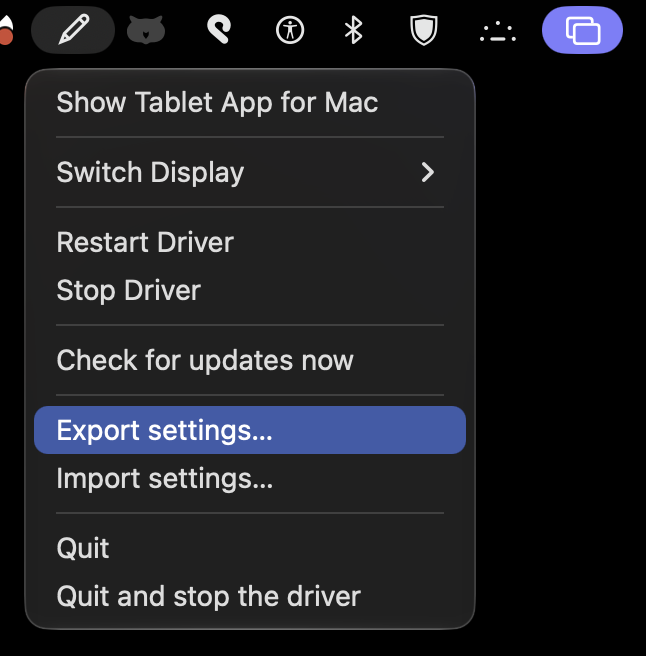

The **driver** is the background part of the app that reads the pen and moves the pointer. It keeps working while the window is closed.

- **Show Tablet App for Mac** opens the app's window.
- **Switch Display** chooses which screen the tablet draws on, when you have more than one screen.
- **Restart Driver** stops the background part and starts it again. Try this first if the pen stops responding.
- **Stop Driver** stops the background part, so the pen stops working until you start it again. While it is stopped, the menu shows **Start Driver** instead.
- **Check for updates now** checks for a new version (see Updating).
- **Report a problem or send a recommendation…** opens the app's window with the report in it (see Report a problem or send a recommendation).
- **Export settings…** and **Import settings…** open the app at Settings › System and do the same as the buttons there.
- **Quit** closes the app and removes the pen icon. The background part keeps running, so the pen still works with the settings you saved.
- **Quit and stop the driver** closes the app and stops the background part too, so the pen stops working until you open the app again.

## Quitting

- **Cmd+Q** quits the app straight away, without asking. Unsaved changes are kept and offered at the next launch. If the app started the driver, the driver stops too, so the pen stops working until you open the app again.
- To close only the window, click its red close button. The app stays in the menu bar and the tablet keeps working.
- **Quit** in the pen menu closes the app; **Quit and stop the driver** also stops the pen (see The pen menu). With unsaved changes it asks "Save changes before quitting?": **Cancel** keeps the app open, **Don't Save** quits without saving, **Save** saves and quits.
- Quitting also happens at shutdown and logout; unsaved changes are then kept and offered at the next launch.

## Tested system and tablet

Our own test system: macOS 27.0.1 on Apple silicon, Wacom Intuos4 Small (PTK-440), tested with every version.

People using the app have told us it works with these tablets:

| Tablet | Model | Tested with |
|---|---|---|
| Intuos3 6x11 | PTZ-631W | Version 29 |
| Intuos4 Medium | PTK-640 | Version 26, including the ExpressKey displays |
| Intuos5 touch Small | PTH-450 | Version 25 |
| Intuos5 touch Medium | PTH-650 | Version 29 |
| Intuos5 touch Large | PTH-850 | Version 28 |
| Intuos Pro Medium (2013) | PTH-651 | Version 21, including the Wireless Kit |
| Intuos S Bluetooth | CTL-4100WL | Version 28, over USB and Bluetooth |
| Bamboo Fun Small (Pen & Touch) | CTH-461 | Version 28, including finger touch |

Is your tablet working, or not yet? Tell us on the Tablets page of the app's GitHub discussions: https://github.com/DigitalGroceries/tablet-app-for-mac/discussions/categories/tablets

## Supported tablets

**Supported tablets** (in **About**) lists every tablet the driver knows, with its support level (**Supported**, **Has Quirks**, **Questionable** or **Missing Features**) and notes. The Wacom tablets are also listed on the website: https://digitalgroceries.github.io/tablet-app-for-mac/tablets/

Version 16 adds the following. None of it has been tested on these tablets yet, so please tell us how it works (**Feedback** on **Home**):

- Intuos Pro (PTH-460, PTH-660, PTH-860): the Touch Ring turns the right way and its zero is at the left, like other Wacom rings.
- Intuos3 (PTZ-430, PTZ-431W, PTZ-630, PTZ-631W, PTZ-930, PTZ-1230, PTZ-1231W), Cintiq 21UX (DTZ-2100 and DTK-2100), Cintiq 12WX (DTZ-1200W) and Cintiq 22HD (DTK-2200, DTH-2200): touch strips (see Touch ring).
- Cintiq 13HD (DTK-1300, DTH-1300): the centre button of the Rocker Ring, as ExpressKey 9.
- Bamboo Fun (CTE-450, CTE-650): the Touch Ring.
- Wacom CTK-4120: newly listed.

Version 19 adds: Cintiq 21UX (DTK-2100) and Cintiq 22HD (DTK-2200, DTH-2200): the ExpressKeys are read the way the Linux Wacom driver reads them, so each key sends its own setting. If you set up these keys in an earlier version, check them once on **Tablet › Functions › ExpressKeys**; the app shows a note in the main window. Not yet tested on these tablets.

## Wacom driver conflict

The Wacom driver and OpenTabletDriver cannot both use the tablet. Quit or uninstall the Wacom driver before using this app. Home shows a warning while it is running. The app also checks which programs are running every 15 seconds and shows **Another tablet driver is running** on **Home** when it finds the Wacom driver (WacomTabletDriver, TabletDriver, Wacom_IOManager, WacomTabletSpringboard, DataStoreMgr), the Xencelabs driver, or a second OpenTabletDriver daemon.

## Updating

**Version 19:** messages and dialogs now open inside the main window, not as separate windows.

**Permissions:** from Version 18 on, updates keep both permissions; there is nothing to do. **Updating from Version 17 or older:** once, in System Settings › Privacy & Security › **Input Monitoring** and **Device Control and Data Access** (called **Accessibility** on older macOS), remove the old Tablet App for Mac entries with **−**, add the app with **+** and switch it on.

- The app checks for updates every time it starts, quietly: nothing appears on your screen. When there is a new stable version and you opened the app yourself, it asks **Update now?** Click **Update now** and the app downloads it, checks it, installs it and opens again by itself. When the app started by itself as your Mac started, it stays silent; the new version waits on **Home** as **Install Version N** until you open the app.
- To check any time, click **Check for updates now** on **Home** (top right, under the About links). When there is a choice, Home shows **Install Version N** (the newest stable version) and **Try Version N BETA M** (a BETA: new features, not tested yet). While you use a BETA, **Previous Version** returns you to the stable version (the full name, **Go back to Version N**, is in the tooltip).
- **Update automatically** is an optional setting just below it. It is off unless you turn it on. When it is on, the app downloads a new stable version by itself, then asks for OK before installing. It never installs a BETA by itself.
- To go back to an earlier version, click **Earlier versions…** on **Home** and choose one of the two most recent stable versions older than the one you have. This works from a stable version and from a BETA. Your settings stay.

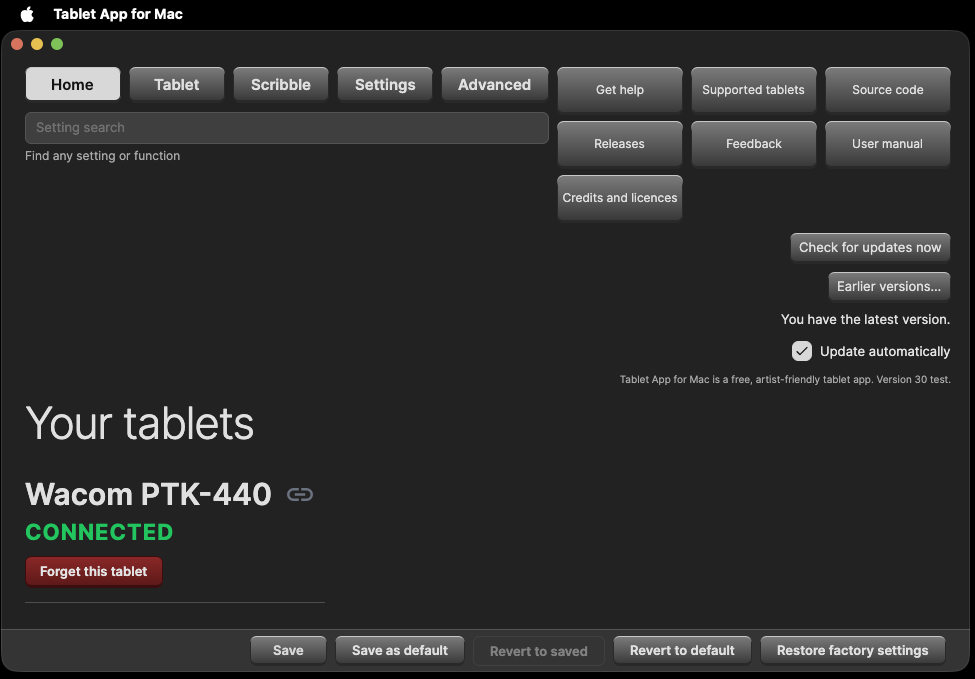

- The two permissions are asked for only at the first installation. Updates from Version 18 on keep them.
- **Coming from Version 6:** install Version 7 or later by hand once (see Install and first launch). Then do the one-time step for Version 17 or older above.
- **Permission switches turn themselves off?** macOS is still holding the entries of Version 17 or older. Make sure the app is in **Applications** (not opened from the disk image or Downloads). On **Home**, click **Reset permissions**. Then in System Settings › Privacy & Security › **Input Monitoring** and **Device Control and Data Access** (called **Accessibility** on older macOS): select every old Tablet App for Mac entry and remove it with **−**, then click **+**, add Tablet App for Mac from Applications, switch it on, and restart the app. In Terminal the same reset is `tccutil reset ListenEvent com.freetabletapp.mac` and `tccutil reset Accessibility com.freetabletapp.mac`.
- **By hand, if you prefer:** quit the app, replace it in Applications with the new version, and open it.

## Going back to an earlier build

Click **Earlier versions…** on **Home** (Version 15 and later), or download an earlier build from Releases and replace the app. Settings are kept. Going back to Version 17 or older needs the one-time − then + step under Updating.

## Uninstalling

- Quit from the menu bar.
- Delete the app from Applications.
- Remove its entries from **Input Monitoring** and **Accessibility** (on macOS 27: **Device Control and Data Access**) with **−**.
- Remove its Login Item if you added one (System Settings › General › Login Items).
- Optional: delete its settings folder, ~/Library/Application Support/Tablet App for Mac.

## Credits and licences

Tablet App for Mac is a modified version of OpenTabletArtist by TheSevenPens (GPL-3.0) and uses OpenTabletDriver (LGPL-3.0). The full list of packages and licence texts is on the Credits and licences page. Some features (settings backup, the diagnostic file and the running-driver check) use ideas from MockTab by Cyzor (GPL-3).

## Glossary

- **Tip Feel**: the pressure curve, from Soft to Firm.
- **Double Click Fix**: how far the pen tip may wobble during a click before it counts as a drag (Off = 0, Default 50 = 1 mm, 100 = 2 mm).
- **Double Click**: a pen-button or ExpressKey action that posts a left-button double-click at the cursor.
- **Touch Ring modes**: up to four sets of ring actions, switched with the centre button.
- **Touch strip**: the finger strip on Intuos3 and older Cintiqs. It works like the ring, with Up and Down.
- **Preset**: a named copy of the whole configuration.
- **Application row**: per-app settings; **All** applies everywhere else.
- **Driver**: the background part of the app that reads the pen and moves the pointer, built on OpenTabletDriver.
- **BETA**: a new version that is not tested yet. You can go back to the stable version at any time.

## Not written here

The per-app notes (Photoshop, Affinity, PhotoCraft) are written separately. Per-app shortcuts: not yet tested.
